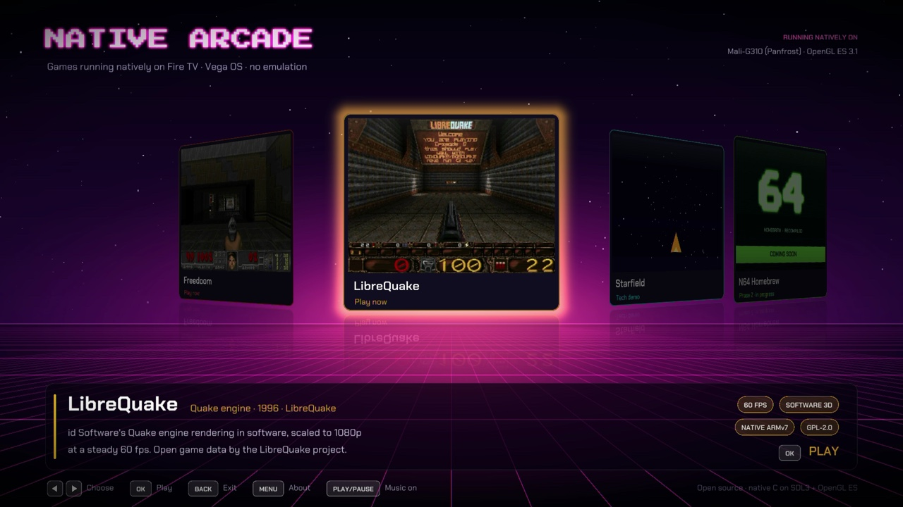

# Fire TV Native Games

An experiment in getting games running **natively** on Amazon Fire TV devices running **Vega OS**, Amazon's Linux-based TV operating system. Native here means compiled C/C++ talking straight to the device's graphics, audio and input APIs, not an emulator or a web wrapper. The porting work is done with Claude Code.

> Status: **seven games run natively on a Fire TV Stick (Vega OS)** behind a native **arcade launcher**, on our SDL3 port: **Gravity Choir**, an original game made for this project (60 fps, music synthesized live); Freedoom with OPL3 music (56–60 fps); LibreQuake with its soundtrack (59.9 fps); SuperTux; SuperTuxKart, the 3D kart racer (60 fps on the lighter tracks, 25–59 on the busiest); and two **N64 homebrew games statically recompiled from MIPS to ARM**, Brew Volley and Land Grab. See the [case study draft](docs/case-study/README.md).



## Goals
1. A native game foundation for Vega OS: window, OpenGL ES, remote and gamepad input, audio, app lifecycle. Ideally this takes the form of an SDL3 backend.
2. Open-source games running on it, starting with a Doom source port and Freedoom.
3. **N64 static recompilation** on Fire TV. N64 MIPS binaries are recompiled into native C with [N64Recomp](https://github.com/N64Recomp/N64Recomp), starting with freely licensed libdragon homebrew.

See [PLAN.md](PLAN.md) for the roadmap and [RESEARCH.md](RESEARCH.md) for the feasibility notes.

## How native is it?
Fully native. Every app here is a C/C++ shared library compiled for the stick's 32-bit ARM CPU. There is no React Native, no JavaScript, no web view and no emulator.

- **Entry point.** Vega loads `lib/armv7/<package-id>.entry_point_factory.so` from the package and calls the component factory it exports. `engine/vegaplat` implements that `IInteractiveComponent` (lifecycle, window, input, audio); SDL3 and the game run on top, with the game's own `main()` on its own thread.
- **Manifest.** Each `manifest.toml` declares an interactive component with **no `runtime-module`**, so Vega starts no JavaScript runtime. The `package.json` is there only because `vega build` requires one (`"kepler": {"projectType": "native"}`); it has no scripts and no dependencies.
- **What ships.** The Doom package holds one 2.7 MB ARM ELF library, the manifest, an icon and the Freedoom WAD. That library links only `libc`, `libm`, the dynamic loader and `libapmf` (Vega's component framework). OpenGL ES is loaded at run time from the system's Mesa driver.
- **N64 titles.** N64Recomp translates the game's MIPS machine code to C ahead of time, and that C is compiled for ARM: the CPU runs ARM code, with no interpreter or JIT. The N64's graphics, audio and controller hardware is replaced by C implementations of the libdragon calls that drive it. The package also carries the homebrew ROM image, because the game reads its sprites and fonts from it; the MIPS code inside is never executed.

## Quick start
Needs: macOS or Linux, the [Vega SDK](https://developer.amazon.com/docs/vega/2.0/install-vega-sdk) (`source ~/vega/env`), and a Vega Fire TV stick in developer mode, connected over USB.
```bash
tools/fetch-deps.sh                                   # pinned, checksummed SDL3, doomgeneric, Freedoom, LibreQuake, ...
for a in doom quake sdl-demo arcade; do tools/vega.sh build apps/$a armv7 Release && tools/vega.sh install apps/$a armv7 Release; done
tools/vega.sh launch com.firetvnative.arcade.main   # starts the Native Arcade, which launches the rest
```
Each game also runs on its own (`tools/vega.sh run apps/doom com.firetvnative.doom.main armv7 Release`). `apps/vega-probe` prints a device capability report. To preview the arcade on a Mac without a device, run `apps/arcade/host-preview.sh`. The N64 titles also need the MIPS toolchain and libdragon: see [n64/README.md](n64/README.md).

## Repository layout
| Path | What |
|---|---|
| `engine/vegaplat` | C platform layer over Vega's native interfaces (lifecycle, GLES, input, audio, paths) |
| `engine/sdl3-vega` | SDL3 video and audio drivers for Vega, plus CMake integration (`vega_add_sdl3_app`) |
| `apps/arcade` | Native Arcade: the TV launcher for everything here (coverflow UI, generated synthwave music) |
| `apps/doom` | doomgeneric + Freedoom: our SDL3 backend, sound-effects mixer, OPL3 music driver |
| `apps/quake` | quakegeneric + LibreQuake: our SDL3 backend, restored WinQuake mixer with an SDL3 DMA driver, OGG soundtrack |
| `apps/sdl-demo` | SDL3 renderer, input and audio demo |
| `apps/supertux` | SuperTux 0.7 (GPL-3.0): SDL2 game code on sdl2-compat over our SDL3 backend, all dependencies built from source |
| `apps/gravity-choir` | Gravity Choir, an original game: a neon arena where enemies die only by colliding and every crash is a note; music synthesized live (MIT) |
| `apps/supertuxkart` | SuperTuxKart 1.5 (GPL-3.0): the 3D kart racer on OpenGL ES 3, its data trimmed for the stick (ASTC textures) |
| `engine/sdl2-compat-vega`, `engine/thirdparty` | SDL2 API on our static SDL3 (renamed symbols), and pinned third-party libraries built per app |
| `n64/jam24/` | Static-link harness for N64brew Game Jam 2024 minigames (`tools/n64-jam24.sh`) |
| `n64/` | N64 static recompilation: N64Recomp configs and HLE rules (`recomp/`), the n64rt runtime and libdragon HLE (`runtime/`), host runner ([n64/README.md](n64/README.md)) |
| `apps/n64-*` | Recompiled N64 programs packaged for Vega (helloworld, Brew Volley, Land Grab from the N64brew Game Jam 2024) |
| `apps/vega-probe` | pure-C++ Vega capability probe |
| `apps/gpu-bench` | GPU/CPU benchmark (fill, shader math, particles, bloom, draw calls, CPU threads); results and a 60 fps budget in [docs/research/gpu-bench.md](docs/research/gpu-bench.md) |
| `tools/` | `vega.sh` (build, install, launch, key injection, screenshot, logs), `fetch-deps.sh` |
| `docs/` | [porting guide](docs/PORTING.md), case study, journal, status, decisions |

## Target hardware
| Device | OS | CPU | GPU | RAM |
|---|---|---|---|---|
| Fire TV Stick 4K Select (2025) | Vega OS 2.0 | 4× Cortex-A55 (armv7 userspace) | Mali-G310 v2 | 1 GB |
| Fire TV Stick 4K, 3rd gen (2026) | Vega OS 2.0 | 4× Cortex-A55 (armv7 userspace) | Mali-G310 v2 | 1 GB |
| Fire TV Stick HD (2026) | Vega OS 2.0 | 4× Cortex-A55 (armv7 userspace) | Mali-G310 v2 | 1 GB |

## Game data policy
This repository contains **no ROMs, no game dumps, no keys and no extracted game assets**, and never will. Commercial games are only supported as builds you make yourself from a dump of a cartridge you own. Anything distributed from this project uses open-source or freely licensed content only.

## License
- **Engine, tools, demos, the arcade launcher and Gravity Choir:** MIT, © 2026 Mitul Shah ([LICENSE](LICENSE)). The exceptions below have their own LICENSE files, which take precedence for those directories.
- **`engine/sdl3-vega/src`** (the SDL video and audio drivers): zlib, the same license as SDL ([LICENSE.txt](engine/sdl3-vega/LICENSE.txt)).
- **`apps/doom` and `apps/quake`:** GPL-2.0-or-later, because they link GPL engine code (doomgeneric, Chocolate Doom, id's WinQuake). See the LICENSE file in each directory.
- **`apps/supertux` and `apps/supertuxkart`:** GPL-3.0-or-later, like the games they build. See the LICENSE file in each directory.
- **Third-party components keep their own licenses:** SDL (zlib), Nuked OPL3 (GPL-2.0-or-later, as shipped in Chocolate Doom 2.3.0), Freedoom (BSD-3), LibreQuake (BSD-3 art, GPL-2 QuakeC), SuperTux and SuperTuxKart data (mostly CC-BY-SA and GPL, with a few CC BY-NC items), the N64 homebrew (MIT, with Land Grab's music under CC BY-NC 4.0). Each package's `NOTICE.txt` has the details.
- **The Amazon Vega SDK is not included.** Install it yourself under Amazon's terms.

Every package ships its licences and credits under `assets/licenses/`: a `NOTICE.txt` (what the app contains, the exact upstream versions, each component's licence and a link to this source), the app's own LICENSE, and the licence texts of the libraries and assets it includes. The build copies them in (`vega_app_license()` in `engine/sdl3-vega/SDL3Vega.cmake`); each app's `NOTICE.txt` lives next to its `CMakeLists.txt`.
