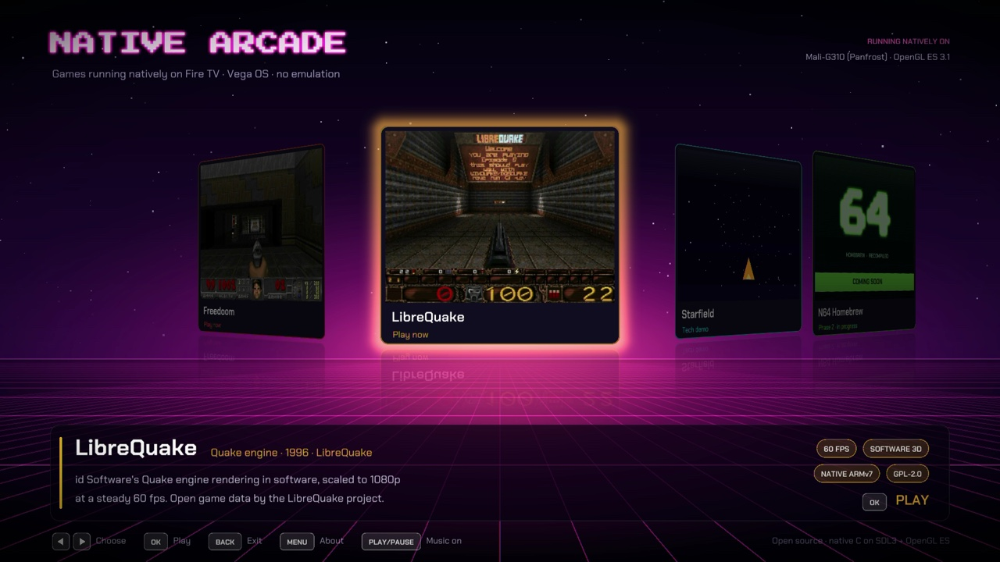
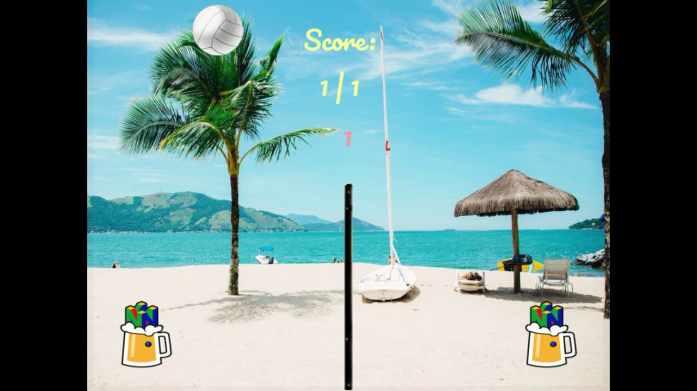
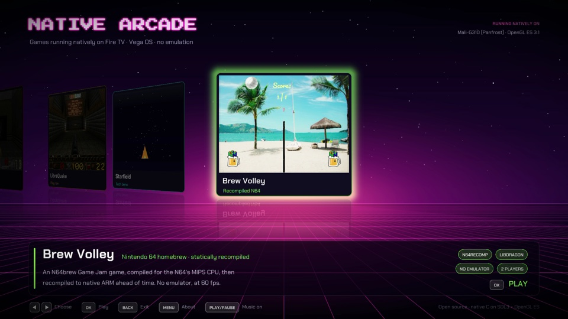
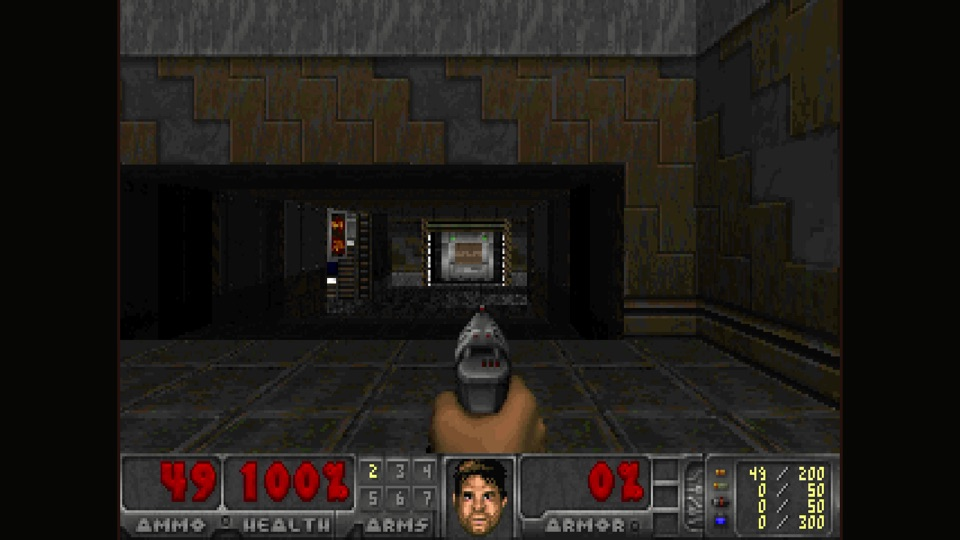
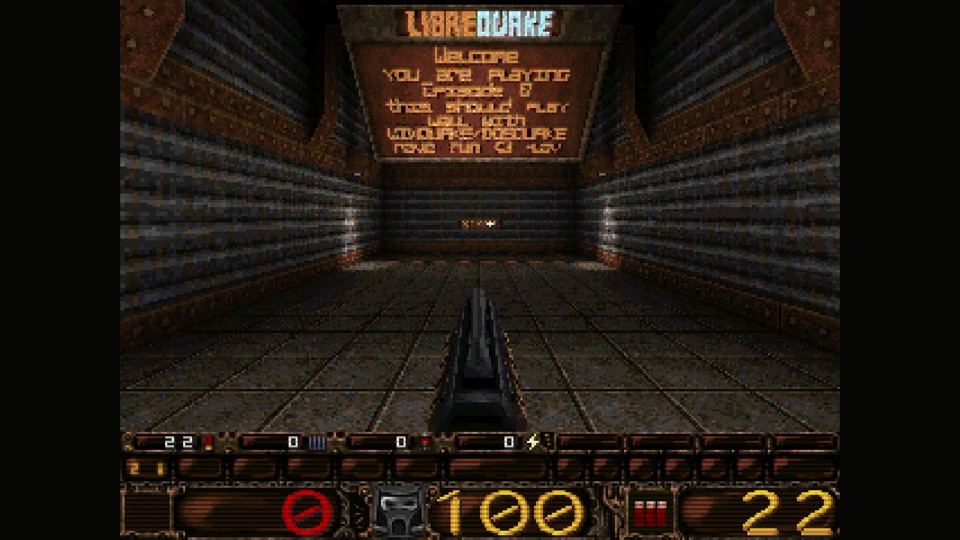

# Case study (draft): Claude Code brought native games to Amazon's new Fire TV OS

> **Status:** draft written during the project (Day 0, 2026-11-07). The raw, timestamped log is in [journal.md](journal.md), and the on-TV screenshots are in [media/](media/).

## TL;DR
In one working session, mostly unattended, Claude Code:
- **Reverse-engineered the native app model** of Vega OS, Amazon's new Linux-based Fire TV operating system. Officially it's React Native and web only.
- **Wrote an SDL3 backend for it**, so the open-source SDL game ecosystem can target Fire TV.
- **Shipped Doom and Quake running natively** on a Fire TV Stick, using free game data (Freedoom, LibreQuake).
  - Doom has authentic OPL3 FM music and runs at 56–60 fps in 54 MB.
  - Quake runs at a steady 59.9 fps with its soundtrack.
  - Both have sound and remote or gamepad controls.
- **Built a native "arcade" launcher** that ties it all together: a coverflow carousel over a synthwave stage, with music synthesized live.
- **Statically recompiled a Nintendo 64 homebrew game to run natively on the Fire TV.** *Brew Volley*, an N64brew Game Jam game, plays at 60 fps. Its MIPS code was translated to C with N64Recomp and compiled for the stick's ARM CPU, with hardware-facing libdragon calls reimplemented on SDL3. No emulator.



| | |
|---|---|
|  |  |
| Brew Volley: N64 MIPS code statically recompiled to ARM, 60 fps on the TV | Launched from the Native Arcade |
*The Native Arcade, captured from the TV. Every pixel is drawn by our C code through OpenGL ES; the music is synthesized live.*

| | |
|---|---|
|  |  |
| Freedoom: Phase 2, natively, with OPL3 music | LibreQuake, natively, 59.8 fps |

*Screenshots were captured from the TV itself by Claude, using an on-device tool it found while exploring.*

## Why this is hard
- **Not Android.** Vega OS is Amazon's own Linux. Android APKs don't run, and Amazon's documentation covers React Native and web apps. A C++ "native lane" exists, but it's documented as an add-on to React Native apps.
- **Small hardware.** The new sticks have a 32-bit ARMv7 userspace, 1 GB of RAM (420 MB per app), a Mali-G310 GPU, and **no Vulkan**.
- **A brand-new SDK.** Vega SDK 2.0 went GA on Oct 29, 2026, and native tooling is still marked "open beta".

## What Claude built
```
 game code (Doom / any SDL3 app) ─┐
                                   ▼
             SDL3 3.4.18  +  our "vega" video & audio drivers      (engine/sdl3-vega)
                                   ▼
             vegaplat: tiny C platform layer                         (engine/vegaplat)
     lifecycle · GLES window · input queue · audio focus/stream · paths
                                   ▼
     Vega OS native interfaces (APMF/IDL): graphics, input, audio, app lifecycle
```
- **`apps/vega-probe`:** the first pure-C++ Vega app. It maps the device: Mesa/Panfrost GLES 3.1, no Vulkan, 2.7 GB of reservable address space, and executable memory allowed (so a JIT is possible).
- **`engine/vegaplat` and `engine/sdl3-vega`:**
  - Remote keys become keyboard events, and game controllers become an SDL virtual gamepad.
  - The Vega lifecycle maps to SDL's background, foreground and quit events.
  - Audio flows through Amazon's audio focus and stream services.
  - SDL is built from pinned source with a 5-line idempotent patch.
- **`apps/doom`:**
  - doomgeneric with Claude's SDL3 platform backend: 4:3 pixel-art scaling, a TV control scheme, and a controls overlay.
  - A DMX sound-effects mixer.
  - Chocolate Doom's MIDI→OPL player driving the Nuked OPL3 emulator, through an SDL3 OPL driver Claude wrote.
- **`apps/arcade`:** the Native Arcade launcher. It renders cards to textures, tilts them with a perspective projection, reflects them on a grid floor that scrolls to the beat, and launches each game through the OS's own message router.
- **`tools/vega.sh`:** a one-command loop of build, install, launch, inject remote keys, screenshot the TV and stream logs. This let Claude test on real hardware with no human in the loop.

## Discoveries along the way (the interesting part)
1. **The native app model exists, just undocumented as a standalone path.** The SDK's own `application-overview.md` describes `IInteractiveComponent` plus an `<pkg-id>.entry_point_factory`. `vega build` needs a `package.json` with `projectType: "native"`, which Claude found by reading the CLI bundle.
2. **The SDK headers declare constants that no library defines**, for example `WindowRole::APPLICATION` and `SampleFormat::PCM_16_BIT`. With CMake's plain `add_library`, the app linked fine and then failed on the TV with only "Returned error -1 from LAUNCH callback". Switching to the SDK's strict `kepler_add_library` turned it into a build error, and constructing the values from the IDL literals fixed it.
3. **The SDK's C audio API can't compile** (it needs a missing `Vntk.h`). The IDL audio API works, but only after declaring `com.amazon.audio.*` services in the manifest. Without them the error is an opaque "IPC link unsuccessful".
4. **A segfault inside Amazon's window system** (`libgwsi`) was diagnosed from a crash tombstone Claude pulled off the device. The window system holds only a raw pointer to input listeners, so they must stay alive for as long as they're registered.
5. **A self-inflicted outage, caught and fixed.** Claude's early screenshot attempts left two hung processes holding about 440 MB of a 1 GB stick, and the OS then killed the game. Claude traced it through the memory-pressure logs, killed the strays (free memory went from 133 MB to 576 MB), and wrote the lesson into its project memory.
6. **The device log drops a new process's first seconds of output**, so the platform layer replays its early log lines after 6 s.
7. **Updating a running app can silently keep the old build installed.** Claude caught this when a fix "didn't work": the screen still showed the old build's behaviour. The install tool now stops the app first and falls back to uninstall+install.
8. **Claude caught its own false claim.** An early "Doom player walked forward" check used an invalid key-injection syntax that pressed nothing. Claude found this while debugging Quake, re-verified Doom movement properly, and corrected the journal.

9. **Launching one app from another isn't documented natively.** Claude found the answer in the SDK's messaging IDL: send a message to `pkg://<component>`, and the lifecycle manager launches it, as the home screen does.
10. **SDL3 never queues "entered background/foreground" events.** They go only to event-watch callbacks. Claude found this when the arcade sometimes failed to wake up after a game exited, then fixed all four apps and corrected its own porting guide.
11. **TV remotes have no Y key.** Doom's and Quake's quit prompts both say "press Y". Driving the full launch → play → quit loop on the TV exposed it.

12. **Eight things N64Recomp couldn't handle in modern libdragon code**, each patched at build time: trap instructions, memory barriers, coprocessor-0 registers, GCC's clone names, atomics, EMUX debug opcodes, 64-bit float truncation, and per-function failures.
13. **Some code can't be statically recompiled at all.** GCC nested functions build trampolines on the stack at run time. Hand-written assembly decompressors race the cartridge DMA by polling hardware registers. Claude found both through crashes and replaced them with host code.

## Numbers
| Metric | Value |
|---|---|
| Doom frame rate (1080p, 4:3 pixel-art scaled) | 56–60 fps (game sim 35 Hz) |
| Doom memory | 54 MB RSS (cap 420 MB) |
| Doom package size | 10 MB (Freedoom 2 WAD included) |
| Quake (LibreQuake, 320×240 software renderer → 1080p) | 59.7–59.9 fps presented, 66–73 MB RSS, OGG soundtrack |
| Native Arcade (coverflow, render-to-texture, live synth) | 59.9 fps, 48 MB RSS, 1.6 MB package |
| N64 helloworld (recompiled MIPS → ARMv7) | 59.9 fps; 486 functions; 1.2 MB package |
| Brew Volley (recompiled N64 game) | 59.6–60.1 fps; 533 functions recompiled + 252 replaced by host code; 2.2 MB package |
| SDL3 demo | 59.9 fps, OpenGL ES 2 renderer |
| Audio | 48 kHz s16 stereo, 768×2-frame buffers, about 75 ms latency, 0 underruns |
| Cold launch to first frame | about 1.2 s |
| Third-party code edited | none (pinned + checksummed sources; tiny build-time patches and shims) |

## Ground rules we kept
- **No commercial ROMs or game data.** Doom runs on **Freedoom** (BSD-licensed original assets). The WAD is fetched and checksummed at build time and never committed.
- **No Amazon SDK files or template code in the repo.** The SDK is proprietary, so it's a build dependency only.
- **Licenses:**
  - Our code is MIT, © 2026 Mitul Shah. The SDL3 drivers are zlib, so they can be upstreamed.
  - The Doom and Quake apps are GPL-2.0-or-later, because they link GPL engines.
  - Third-party licenses: SDL zlib, Nuked OPL3 LGPL-2.1+, Freedoom and LibreQuake BSD-3, fonts SIL OFL 1.1.

## What's next
- **N64 audio.** libdragon's mixer runs on the RSP. The next step is a host mixer, so Brew Volley gets its music and sound effects.
- **More recompiled N64 homebrew** (N64brew jam games are open source), and more of the rdpq API in the runtime.
- More SDL games, and testing across all three Vega sticks.

## Human vs. Claude
- **Human:** chose the direction, attached the device and enabled developer mode, then left. They followed progress remotely by phone, approved the toolchain build, delegated the license choice, and suggested the arcade.
- **Claude:** everything else. Research, SDK spelunking, code, on-device testing (driving the TV with injected key presses and checking screenshots), crash forensics, docs and commits. Usage was capped at the user's request and monitored throughout.
